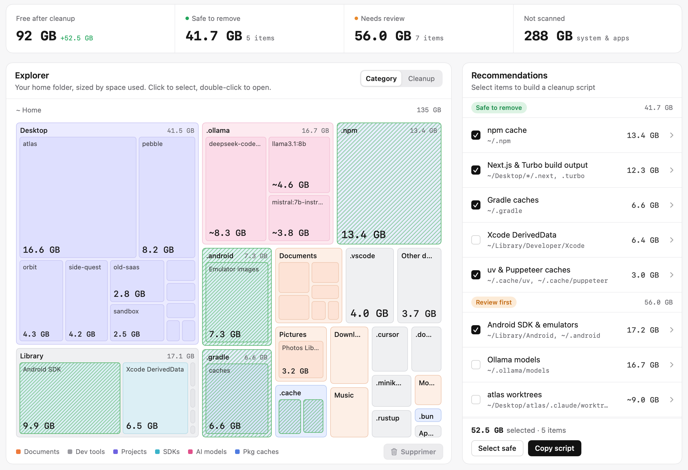
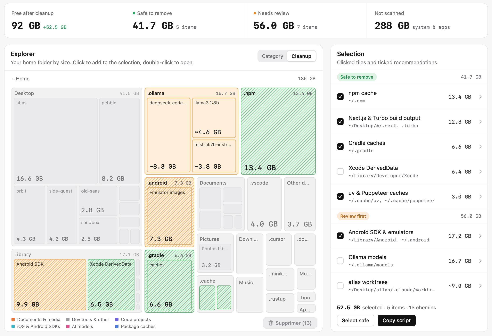
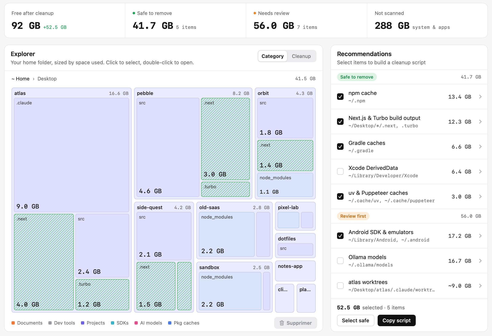
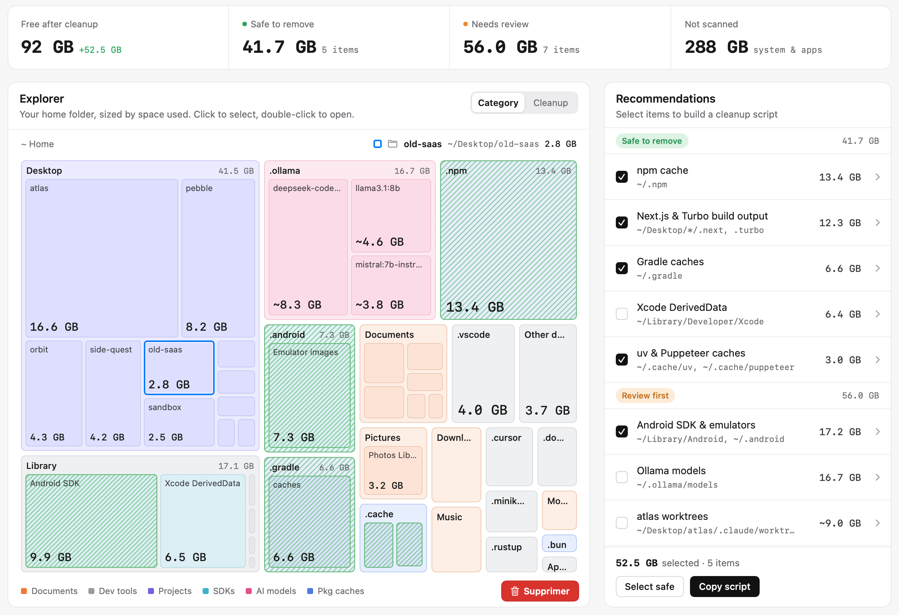
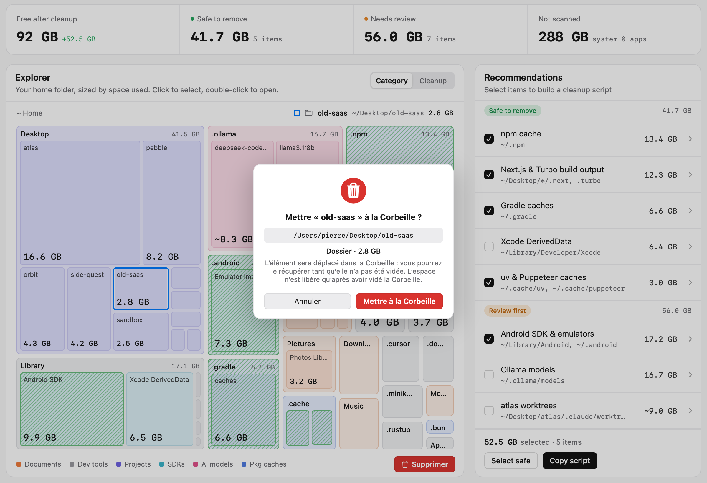
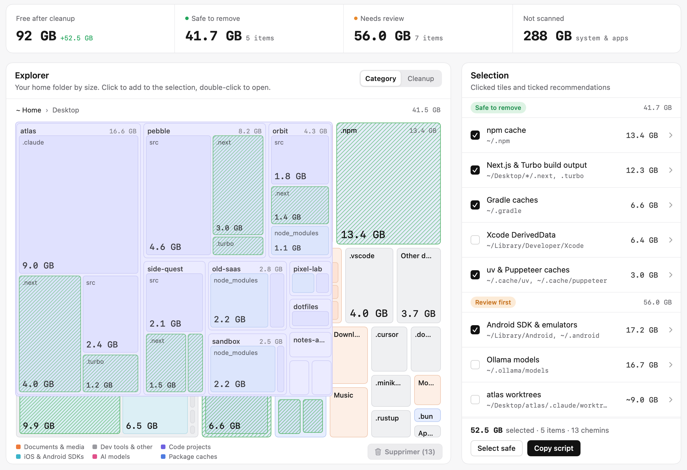
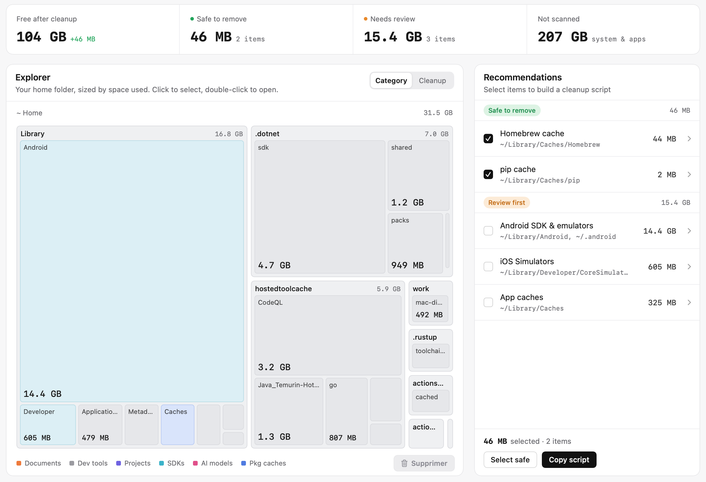

# Disk Cleaner

**Disk Cleaner** est une application macOS native (SwiftUI) qui analyse l'espace occupé par votre dossier personnel, l'affiche sous forme de *treemap* interactive et vous recommande ce qui peut être nettoyé : caches de paquets, sorties de build, SDK, modèles d'IA, worktrees oubliés…

> 🔒 **Rien n'est jamais supprimé définitivement.** Pour les recommandations, l'app génère un script shell lisible que vous copiez, relisez puis exécutez vous‑même dans le Terminal si vous le souhaitez (l'app ne l'exécute jamais). Le bouton **Supprimer** de l'Explorer, lui, ne fait que **mettre à la Corbeille** ce qui est coché, après confirmation : tout reste récupérable tant que la Corbeille n'est pas vidée.





*Zoom sur un dossier (double‑clic sur la tuile « Desktop ») :*



*Sélection multiple : plusieurs tuiles cliquées (contour bleu) apparaissent en tête du panneau de droite, avec les recommandations cochées, et le bouton **Supprimer (N)** est en bas à droite :*



*Confirmation groupée avant la mise à la Corbeille :*



*Animation de zoom au double‑clic (image intermédiaire) :*



*Analyse réelle (dossier personnel du Mac de la CI GitHub, aucune donnée de démo) :*



*(Captures générées automatiquement par la CI en mode démo, avec des données fictives.)*

## Téléchargement

- Dernière version : <https://github.com/pierreburnn/mac-disk-cleaner/releases/latest>
- Lien direct v1.2.0 : [DiskCleaner-1.2.0.dmg](https://github.com/pierreburnn/mac-disk-cleaner/releases/download/v1.2.0/DiskCleaner-1.2.0.dmg)

Compatible macOS 13 Ventura et plus récent, Mac Apple Silicon **et** Intel (binaire universel).

## Installation

1. Téléchargez le fichier `DiskCleaner-1.2.0.dmg`.
2. Ouvrez‑le, puis glissez **Disk Cleaner** sur le raccourci **Applications**.
3. Éjectez le disque image.

### Premier lancement (application non signée)

L'application est signée « ad hoc » mais n'est pas notariée par Apple : Gatekeeper la bloque au premier lancement. Trois solutions, au choix :

- **Clic droit** (ou Ctrl‑clic) sur *Disk Cleaner* dans le dossier Applications › **Ouvrir**, puis confirmez **Ouvrir**.
- Ou bien : lancez l'app une fois, puis allez dans **Réglages Système › Confidentialité et sécurité**, faites défiler jusqu'au message concernant *Disk Cleaner* et cliquez sur **Ouvrir quand même**.
- Ou bien, dans le Terminal :

  ```bash
  xattr -dr com.apple.quarantine "/Applications/Disk Cleaner.app"
  ```

### Accès complet au disque (recommandé)

Certains dossiers (Mail, Messages, Safari, conteneurs d'apps…) sont protégés par macOS. Si l'analyse n'a pas pu les lire, un bandeau s'affiche avec un bouton **Open Full Disk Access settings** qui mène directement à **Réglages Système › Confidentialité et sécurité › Accès complet au disque**. Ajoutez‑y *Disk Cleaner*, puis relancez l'analyse (bouton **Rescan**).

## Utilisation

- **Statistiques** en haut : espace libre après nettoyage (espace libre actuel + gain sélectionné), total « Safe to remove », total « Needs review », et la part du disque non analysée (système et applications).
- **Explorer** : votre dossier personnel en treemap, chaque rectangle proportionnel à l'espace réellement occupé sur le disque. Utilisez le fil d'Ariane (`~ Home › …`) pour revenir en arrière. Le sélecteur **Category / Cleanup** bascule entre les couleurs par catégorie et la mise en évidence de ce qui est nettoyable (hachures vertes).
- **Simple clic** sur une tuile : elle est **ajoutée à la sélection** (contour bleu). Un nouveau clic sur une tuile déjà sélectionnée l'en **retire**. On peut sélectionner autant de tuiles que l'on veut, y compris dans plusieurs dossiers. **Échap** vide la sélection de l'explorateur.
- **Double‑clic** sur une tuile (dossier parent ou sous‑dossier) : la tuile **s'agrandit** jusqu'à remplir la treemap (≈ 0,35 s), puis son contenu apparaît. Cliquer dans le fil d'Ariane fait l'animation inverse. Avec *Réglages Système › Accessibilité › Affichage › Réduire les animations*, le zoom est remplacé par un simple fondu. Le double‑clic ne modifie pas la sélection.
- **Panneau de droite « Selection »** : la liste de **tout ce qui est sélectionné** :
  - **Selected in explorer** (en tête) : les tuiles cliquées, avec leur nom, leur chemin et leur taille, une case à cocher et un bouton ✕ pour les retirer ;
  - **Safe to remove / Review first** : les recommandations, à cocher comme avant (chevron pour le détail et les chemins, loupe pour les révéler dans le Finder).

  Le total du pied de panneau additionne les deux, **sans compter deux fois** un chemin inclus dans un autre (par ex. un dossier et un de ses sous‑dossiers, ou une tuile déjà couverte par une recommandation).
- **Supprimer (N)** (bouton rouge en bas à droite de l'Explorer, ou ⌘⌫) : met **à la Corbeille tout ce qui est coché** dans le panneau, c'est‑à‑dire les tuiles cliquées et les chemins réels des recommandations cochées. Une seule confirmation liste les éléments, leurs chemins et le total (liste défilante si elle est longue), avec **Mettre à la Corbeille** / **Annuler**. Jamais de suppression définitive : uniquement la Corbeille (`trashItem`). Les chemins suivants sont **ignorés et signalés** :
  - le dossier personnel `~` lui‑même et les dossiers protégés de premier niveau (`~/Library`, `~/Desktop`, `~/Documents`, `~/Downloads`, `~/Pictures`, `~/Music`, `~/Movies`, `~/Applications`, `~/Public`, `~/.Trash`). Leur **contenu** peut être mis à la Corbeille, pas le dossier lui‑même ;
  - tout chemin hors du dossier personnel, y compris via un lien symbolique, et les éléments qui n'existent plus.

  Un résumé s'affiche ensuite (« X mis à la Corbeille, Y refusés ou en erreur », avec le détail). La treemap, les tailles des dossiers parents, les statistiques et les recommandations sont mises à jour sans nouvelle analyse. Le bouton est désactivé quand rien n'est coché, et en mode démo. Pour les recommandations qui passent par un outil dans le script (`npm cache clean`, `brew cleanup`…), le bouton met directement leurs dossiers à la Corbeille ; l'outil n'est pas lancé. ⚠️ L'espace disque n'est réellement libéré qu'une fois la Corbeille vidée.
- **Select safe** coche tous les éléments sans risque. **Copy script** copie le script de nettoyage dans le presse‑papiers et *Fichier › Save Script…* (⌘S) l'enregistre en `.sh`. Les deux utilisent la **même sélection** que le bouton Supprimer : tuiles cliquées et recommandations cochées. L'app n'exécute jamais ce script.

### Recommandations détectées

| Groupe | Élément | Emplacement |
|---|---|---|
| Safe to remove | Cache npm | `~/.npm` (`npm cache clean --force`) |
| Safe to remove | Sorties de build Next.js & Turbo | `.next`, `.turbo` dans vos projets |
| Safe to remove | Caches Gradle | `~/.gradle/caches`, `~/.gradle/wrapper/dists` |
| Safe to remove | Xcode DerivedData | `~/Library/Developer/Xcode/DerivedData` |
| Safe to remove | Caches uv & Puppeteer | `~/.cache/uv`, `~/.cache/puppeteer` |
| Safe to remove | Cache pip | `~/Library/Caches/pip`, `~/.cache/pip` |
| Safe to remove | Cache Homebrew | `~/Library/Caches/Homebrew` (`brew cleanup -s`) |
| Safe to remove | Caches Yarn & pnpm | `~/Library/Caches/Yarn`, `~/.pnpm-store`… |
| Safe to remove | Cache CocoaPods | `~/Library/Caches/CocoaPods` |
| Review first | Android SDK & émulateurs | `~/Library/Android`, `~/.android` |
| Review first | Modèles Ollama | `~/.ollama/models` |
| Review first | Worktrees (Claude Code…) | `<projet>/.claude/worktrees` |
| Review first | `node_modules` de projets inactifs | projets non modifiés depuis 30 jours |
| Review first | Simulateurs iOS | `~/Library/Developer/CoreSimulator/Devices` |
| Review first | Archives Xcode & iOS DeviceSupport | `~/Library/Developer/Xcode/…` |
| Review first | Cache Hugging Face | `~/.cache/huggingface` |
| Review first | Caches d'applications | `~/Library/Caches` (hors éléments ci‑dessus) |
| Review first | Corbeille | `~/.Trash` |

## Sécurité

- Aucune suppression, aucun déplacement de fichier n'est effectué par l'application.
- Le script généré commence par un avertissement, utilise `set -euo pipefail`, vérifie l'existence de chaque chemin avant de le supprimer, protège les chemins (espaces, apostrophes) et **refuse** tout chemin situé hors de votre dossier personnel.
- L'analyse ne suit jamais les liens symboliques et ne traverse pas les autres volumes ; les tailles affichées sont les tailles réellement allouées sur le disque.

## Compiler depuis les sources

Prérequis : macOS 13+ avec Xcode 15 ou plus récent.

```bash
swift build                 # compilation
swift test                  # tests unitaires (XCTest)
swift run DiskCleaner       # lancer l'app
swift run DiskCleaner --demo   # mode démo (données fictives)
scripts/build_app.sh 1.0.0  # .app universelle signée ad hoc + .dmg dans dist/
```

Captures d'écran en mode démo : `"dist/Disk Cleaner.app/Contents/MacOS/DiskCleaner" --snapshot ./screenshots`.
Capture d'une vraie analyse de votre dossier personnel : `… --snapshot-real ./screenshots`.

Le mode démo (`--demo` ou variable d'environnement `DISK_CLEANER_DEMO=1`) sert uniquement aux captures ; en mode normal, toutes les données viennent de l'analyse réelle.

### Architecture

- `Sources/DiskCleanerCore` : logique testable sans interface (analyse du disque, catégories, règles de nettoyage, génération du script, mise en page treemap, formatage des tailles).
- `Sources/DiskCleaner` : interface SwiftUI.
- `Tests/DiskCleanerCoreTests` : tests XCTest (faux dossier personnel temporaire, script, treemap…).
- `.github/workflows/ci.yml` : build, tests, `.dmg`, captures et publication des releases sur les tags `v*`.

## Limitations

- Application non notariée (voir « Premier lancement »).
- Seul le dossier personnel est analysé ; le reste du disque (système, applications) apparaît dans « Not scanned ».
- Les petits fichiers profonds sont regroupés dans leur dossier parent pour limiter la mémoire utilisée.

## Licence

MIT © 2026 LucyLap
